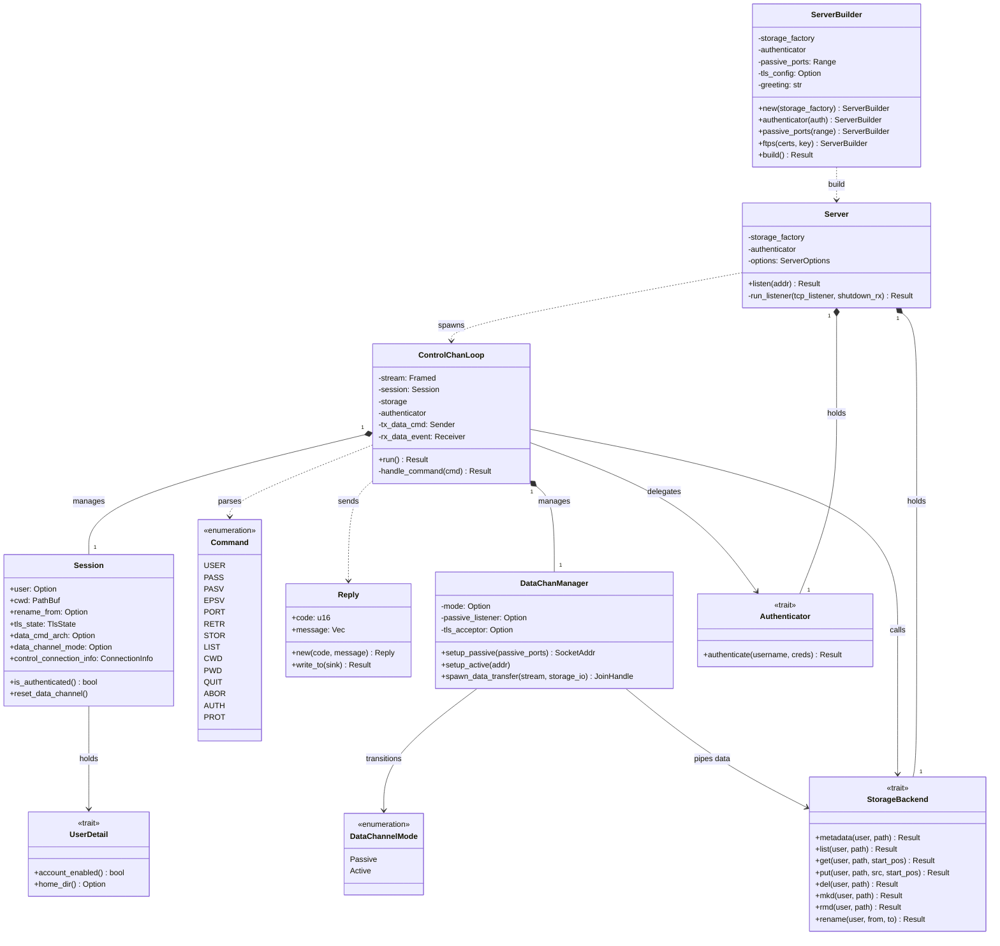

# 内部クラス・主要構造体設計図 (`class_diagram.md`)

## 図の解説

本図は、`libunftp` 本体およびコアクレート（`unftp-core`）を構成する主要な構造体（Struct）、列挙型（Enum）、トレイト（Trait）の静的な依存・所有関係を示しています。

### 1. サーバー構築・待受層 (`ServerBuilder`, `Server`)
- **`ServerBuilder`**: Builderパターンにより、ストレージファクトリ、認証プロバイダ（`Authenticator`）、パッシブポート範囲、FTPS（TLS）設定などを組み立てて `Server` インスタンスを生成します。
- **`Server`**: サーバー全体の設定とプラグイン参照を保持し、`listen()` メソッドでTCPポートをバインドしてクライアント接続を待ち受けます。新規接続ごとに `ControlChanLoop` を生成（spawn）します。

### 2. 制御チャネル・セッション管理層 (`ControlChanLoop`, `Session`, `Command`, `Reply`)
- **`ControlChanLoop`**: クライアント1接続につき1つ生成される制御ループ構造体です。TCPストリームからFTPコマンド（`Command`）をパースし、状態に応じた処理を行って応答（`Reply`）を返します。
- **`Session`**: クライアント接続ごとの状態（認証済みユーザー情報 `UserDetail`、カレントディレクトリ `cwd`、TLS状態、データチャネルのモード等）を保持します。
- **`Command` / `Reply`**: FTPプロトコルの受信コマンド（`USER`, `PASS`, `PASV`, `RETR` 等）と、3桁のステータスコードを持つ応答メッセージを表現します。

### 3. データチャネル管理層 (`DataChanManager`, `DataChannelMode`)
- **`DataChanManager`**: ファイルデータやディレクトリ一覧を送受信するためのデータコネクションを管理します。`PASV`/`EPSV` によるパッシブ待受（`Passive`）や `PORT` によるアクティブ接続（`Active`）の切り替え（`DataChannelMode`）と、非同期データ転送タスクの起動を担います。

### 4. プラグイン抽象化層 (`StorageBackend`, `Authenticator`, `UserDetail`)
- **`StorageBackend` トレイト**: ファイルシステム、クラウドストレージ（S3, GCS等）などのバックエンド実装を抽象化します。メタデータ操作や一覧取得だけでなく、`get` / `put` による非同期ストリーム転送インターフェースを提供します。
- **`Authenticator` / `UserDetail` トレイト**: ユーザー認証ロジック（PAM, REST, JSON等）と認証後のユーザー属性（アカウント有効状態、ホームディレクトリ等）を抽象化し、コアのFTPプロトコル処理と疎結合に保ちます。
