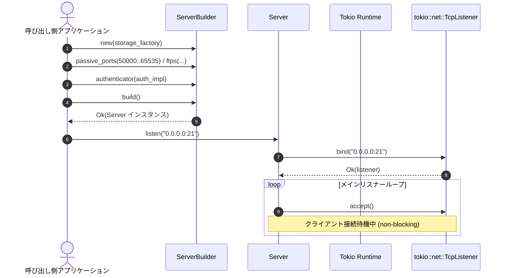

# サーバー起動シーケンス図 (`seq-01_startup.md`)

## 図の解説

本図は、利用者側のRustアプリケーションが `libunftp` を初期化し、FTPサーバーとしてクライアントからの接続待受を開始するまでの起動シーケンスを示しています。

### 処理の流れ
1. **サーバー設定の構築 (ステップ 1〜5)**
   - 呼び出し側アプリケーションは `ServerBuilder::new()` にストレージバックエンドの生成クロージャ（`storage_factory`）を渡してビルダーを初期化します。
   - メソッドチェーンにより、パッシブモードで使用するポート範囲（例: `50000..65535`）、FTPS用の証明書設定、認証プロバイダ（`Authenticator` 実装）などを設定します。
   - `build()` を呼び出すことで設定の検証が行われ、`Server` インスタンスが生成されます。
2. **ソケットのバインド (ステップ 6〜8)**
   - アプリケーションが `Server::listen("0.0.0.0:21")` を非同期呼び出し（`.await`）すると、内部で `tokio::net::TcpListener::bind()` が実行され、指定されたIPアドレスとポートで制御接続の待受ソケットが確保されます。
3. **メインリスナーループへの突入 (ステップ 9)**
   - バインド成功後、サーバーはメインリスナーループに入り、`TcpListener::accept()` で新規クライアントからのTCP接続をノンブロッキングで待機し続けます。
