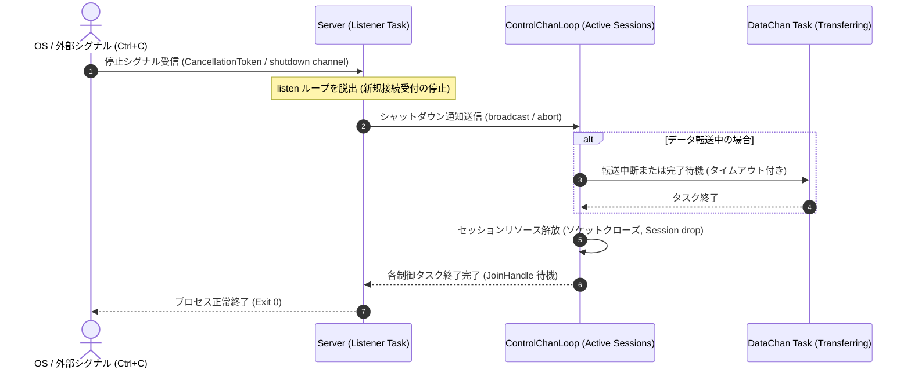

# 終了シーケンス図 / グレースフルシャットダウン (`seq-02_shutdown.md`)

## 図の解説

本図は、OSからの終了シグナル（`SIGINT` / `SIGTERM` 等）やアプリケーションからのキャンセル通知を受け取った際に、`libunftp` が稼働中のセッションやデータ転送を安全に終了させるグレースフルシャットダウンの流れを示しています。

### 処理の流れ
1. **停止シグナルの検知と新規受付停止 (ステップ 1)**
   - `Server` のメインリスナータスクが `CancellationToken` やシャットダウン用チャネル経由で停止シグナルを受信すると、`accept()` 待受ループを即座に脱出し、新規クライアント接続の受付を停止します。
2. **アクティブセッションへの終了通知 (ステップ 2)**
   - 現在接続中の各クライアントを担当しているすべての `ControlChanLoop` タスクに対して、ブロードキャストチャネル等でシャットダウン通知を送信します。
3. **進行中のデータ転送タスクの終了処理 (ステップ 3〜4)**
   - ファイル送受信などのデータチャネルタスク（`DataChan Task`）が稼働中の場合、`ControlChanLoop` は転送の中断またはタイムアウト付きの完了待機を行い、データタスクが孤立（リーク）しないよう終了させます。
4. **リソース解放とプロセス終了 (ステップ 5〜7)**
   - 各 `ControlChanLoop` は制御ソケットをクローズし、`Session` インスタンスを破棄（Drop）してタスクを終了します。
   - すべてのタスクの終了を見届けた後、`Server::listen()` が正常にリターンし、プロセスが終了（Exit 0）します。
