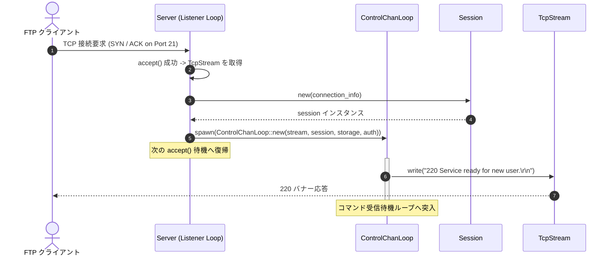

# クライアント接続シーケンス図 (`seq-03_client_connect.md`)

## 図の解説

本図は、FTPクライアントが制御ポート（デフォルト 21番ポート）へTCP接続してから、クライアント専用の非同期タスクが起動され、初期バナー（`220` 応答）が返されるまでのシーケンスを示しています。

### 処理の流れ
1. **TCP接続の確立 (ステップ 1〜2)**
   - FTPクライアントからの3ウェイハンドシェイク（SYN/ACK）が完了すると、`Server` のリスナーループの `accept()` が成功し、クライアント通信用の `TcpStream` と接続元アドレス情報が取得されます。
2. **セッションの初期化と制御タスクの分離 (ステップ 3〜5)**
   - 接続元・接続先情報をもとに、このクライアント専用の `Session` インスタンスを生成します。
   - `TcpStream`、`Session`、および共有の `StorageBackend`・`Authenticator` 参照を渡して `ControlChanLoop` を構築し、`tokio::spawn` によって独立した非同期タスクとしてバックグラウンド実行に移します。
   - メインの `Server` タスクはブロックされることなく、即座に次のクライアントの `accept()` 待機へ戻ります。
3. **初期グリーティング応答の送信 (ステップ 6〜7)**
   - 起動された `ControlChanLoop` タスクは、RFC 959 に準拠した初期バナー応答（`220 Service ready for new user.`）を `TcpStream` へ書き込みます。
   - その後、クライアントから送信されるFTPコマンドの受信待機ループへ入ります。
