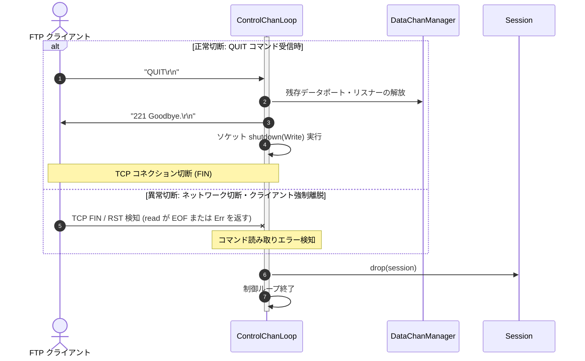

# クライアント切断シーケンス図 (`seq-04_client_disconnect.md`)

## 図の解説

本図は、FTPクライアントとのセッションが終了する際の2つのパターン（`QUIT` コマンドによる正常切断と、通信断などによる異常切断）およびリソース解放処理の流れを示しています。

### 処理の流れ
1. **正常切断パターン (`QUIT` コマンド受信時 / ステップ 1〜4)**
   - クライアントから `QUIT\r\n` コマンドを受信すると、`ControlChanLoop` はまず `DataChanManager` に指示して、確保済みのパッシブポートや残存するデータチャネルリスナーを解放します。
   - クライアントへ終了応答 `221 Goodbye.\r\n` を送信し、制御ソケットの書き込み側をシャットダウン（TCP FIN送信）してコネクションを正常に閉じます。
2. **異常切断パターン (ネットワーク切断・クライアント強制終了時 / ステップ 5)**
   - クライアントの強制終了やネットワーク障害により TCP FIN（EOF）または RST（リセット）が発生した場合、`ControlChanLoop` のストリーム読み取り処理が `EOF` または I/O エラーを検知してループを抜けます。
3. **セッション破棄とタスク終了 (ステップ 6〜7)**
   - 正常・異常いずれの経路でも、ループ終了時に `Session` および関連チャネル・ソケットが Rust の所有権システム（RAII / `Drop`）によって確実に解放され、クライアント担当の非同期タスクが終了します。
