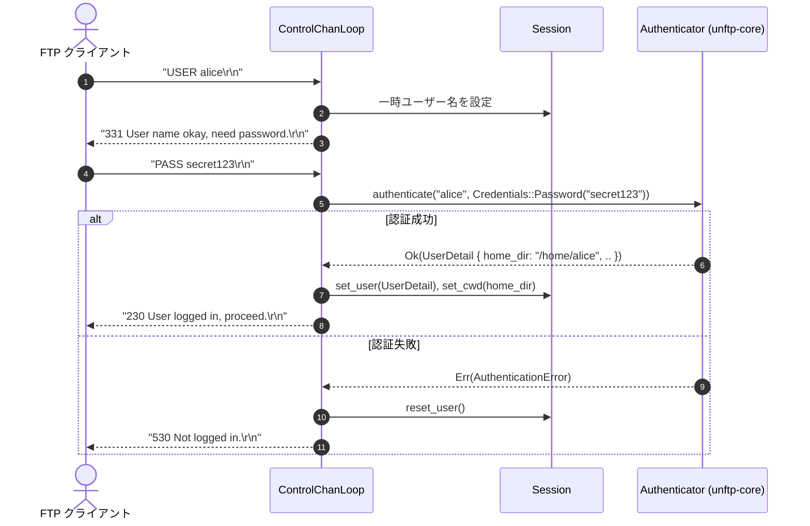

# 認証コマンドシーケンス図: `USER` / `PASS` (`seq-05_cmd_auth.md`)

## 図の解説

本図は、FTPの基本認証コマンドである `USER` と `PASS` の2段階のやり取りと、`unftp-core` の `Authenticator` トレイトを介した認証検証フローを示しています。

### 処理の流れ
1. **ユーザー名の受付 (`USER` コマンド / ステップ 1〜3)**
   - クライアントが `USER alice` を送信すると、`ControlChanLoop` は `Session` 内に認証対象のユーザー名（`"alice"`）を一時保存します。
   - パスワード入力を促す中間応答 `331 User name okay, need password.` をクライアントへ返します。
2. **パスワードの受付と検証委譲 (`PASS` コマンド / ステップ 4〜5)**
   - クライアントが続けて `PASS secret123` を送信すると、`ControlChanLoop` は保持していたユーザー名とパスワード（`Credentials`）をまとめ、`Authenticator::authenticate()` を非同期呼び出しします。
3. **認証結果の反映 (ステップ 6〜11)**
   - **認証成功時**: `Authenticator` から `UserDetail`（ホームディレクトリやアカウント設定等を含む）が返却されます。`Session` に認証済みユーザー情報と初期カレントディレクトリ（`home_dir`）を設定し、`230 User logged in, proceed.` を応答します。以後のファイル操作コマンドはこのユーザー権限で実行されます。
   - **認証失敗時**: `AuthenticationError` が返却された場合、`Session` の一時ユーザー状態をリセットし、`530 Not logged in.` エラーを応答します。
