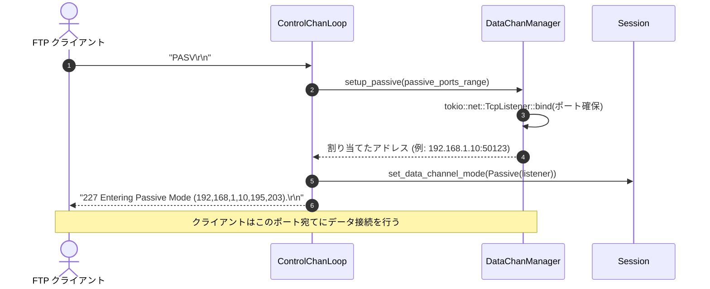

# データチャネル準備シーケンス図: `PASV` (`seq-06_cmd_pasv.md`)

## 図の解説

本図は、ファイル転送や一覧取得に先立ってデータ転送用コネクションをパッシブモードで確立するための `PASV` コマンド処理シーケンスを示しています。

### 処理の流れ
1. **`PASV` コマンドの受信とポート確保 (ステップ 1〜4)**
   - クライアントから `PASV` コマンドを受信すると、`ControlChanLoop` は `DataChanManager::setup_passive()` を呼び出します。
   - `DataChanManager` は、サーバー起動時に設定されたパッシブポート範囲（`passive_ports_range`）の中から利用可能な空きポートを選択し、`tokio::net::TcpListener::bind()` でデータ接続待受用のソケットを確保します。
2. **セッション状態への登録 (ステップ 5)**
   - バインドに成功した `TcpListener`（またはその管理ハンドル）を、`Session` のデータチャネルモード（`Passive`）として登録し、後続の転送コマンド（`RETR`, `STOR`, `LIST` 等）で利用できるようにします。
3. **接続先アドレス・ポートの通知 (ステップ 6)**
   - 確保したIPアドレス（4オクテット）とポート番号（上位バイト・下位バイトの2オクテット、例: `50123 = 195 * 256 + 203`）をカンマ区切りにフォーマットし、`227 Entering Passive Mode (h1,h2,h3,h4,p1,p2).` としてクライアントへ応答します。
   - クライアントはこの応答を受け取ると、通知されたデータポートに対してデータコネクション用のTCP接続を開始します。
