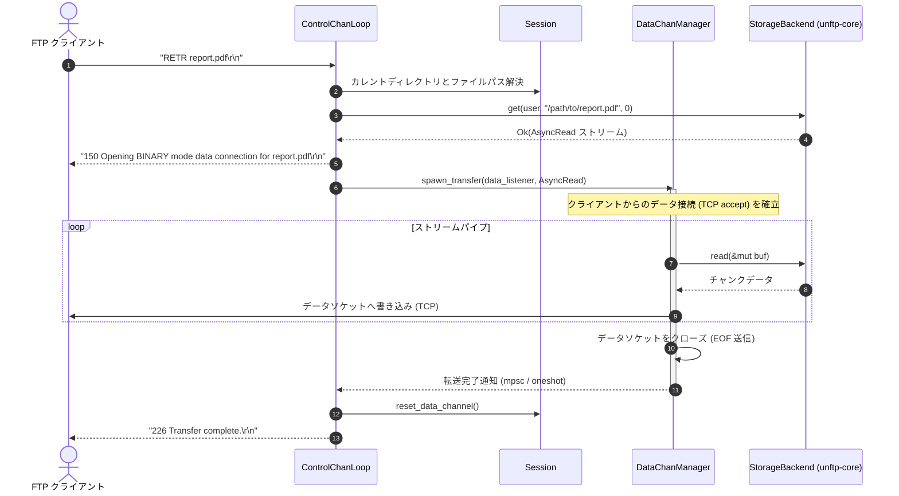

# ファイル転送コマンドシーケンス図: `RETR` (`seq-07_cmd_retr.md`)

## 図の解説

本図は、パッシブモード（`PASV`）等でデータチャネルが準備された後に、クライアントが `RETR` コマンドでファイルをダウンロードする際の制御チャネル・データチャネル・ストレージバックエンド間の連携シーケンスを示しています。

### 処理の流れ
1. **パス解決とストレージストリームの取得 (ステップ 1〜4)**
   - クライアントから `RETR report.pdf` を受信すると、`ControlChanLoop` は `Session` のカレントディレクトリ（`cwd`）と結合して対象ファイルのパスを解決します。
   - `StorageBackend::get()` を呼び出し、ファイル全体を一括でメモリに読み込むのではなく、非同期ストリーム（`tokio::io::AsyncRead`）を取得します。
2. **転送開始の予備応答とデータタスクの起動 (ステップ 5〜6)**
   - ストリームの準備ができると、制御チャネル経由でクライアントへ `150 Opening BINARY mode data connection` を送信します。
   - `DataChanManager` がデータ転送用の非同期タスクを起動し、待機中のパッシブリスナーでクライアントからのデータTCP接続を `accept` します（FTPS `PROT P` の場合はここでTLSハンドシェイクも行われます）。
3. **チャンク単位の非同期ストリーム転送 (ステップ 7〜9)**
   - データタスクは `StorageBackend` の `AsyncRead` ストリームからチャンク単位でデータを読み出し、そのままクライアントのデータソケットへパイプ書き込みします（`tokio::io::copy` 相当）。
4. **データソケットのクローズと完了応答 (ステップ 10〜13)**
   - 全データの送信が完了すると、データタスクはデータソケットをクローズしてクライアント側に EOF（転送終了）を伝え、内部チャネル（`mpsc` / `oneshot`）で `ControlChanLoop` に完了を通知します。
   - `ControlChanLoop` は使用済みのデータチャネル状態をリセットし、制御チャネルから最終応答 `226 Transfer complete.` を返します。
