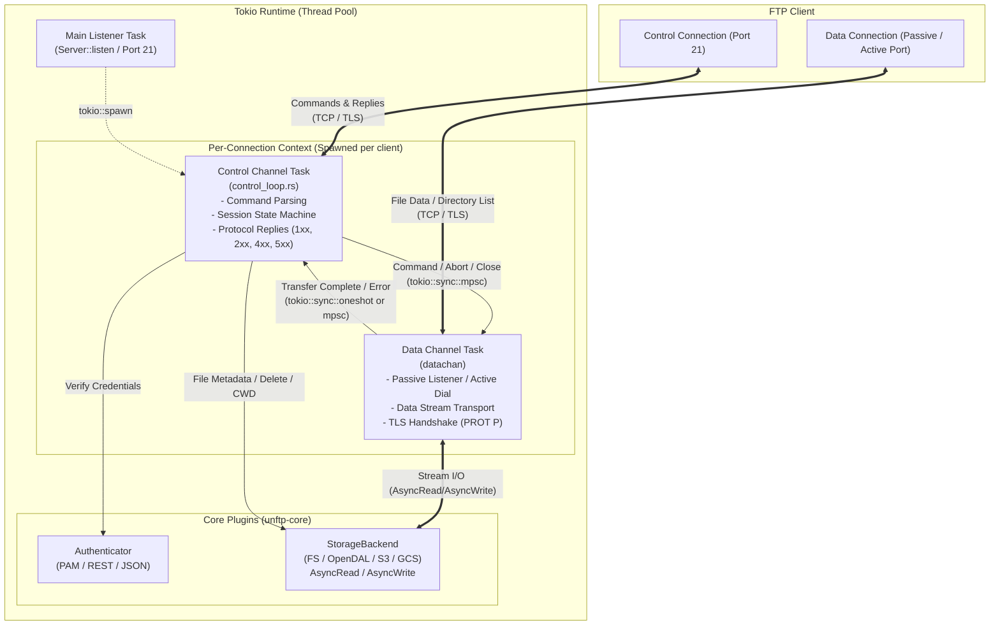

# 非同期タスク構成・チャネル間通信図 (`task-diagram.md`)

## 図の解説

本図は、`libunftp` が Tokio 非同期ランタイム上でどのようにタスクを分割・生成し、FTPの特徴である「制御コネクション」と「データコネクション」の2系統の通信を並行処理しているかを示したアーキテクチャ図です。

### 1. タスクの階層とライフサイクル
- **Main Listener Task (`Server::listen`)**:
  - サーバー起動時に1つ動作する親タスクです。ポート21番で新規クライアントからのTCP接続を待ち受け、接続ごとに `tokio::spawn` で独立した `Control Channel Task` を生成します。
- **Per-Connection Context (クライアント単位のタスク群)**:
  - **Control Channel Task (`control_loop.rs`)**: クライアントの制御コネクション（Port 21）と1対1で対応します。FTPコマンドのパース、セッション状態機械（State Machine）の管理、および応答コード（1xx〜5xx）の返却を行います。
  - **Data Channel Task (`datachan`)**: ファイル転送（`RETR`, `STOR`）や一覧取得（`LIST`）のたびに生成・利用されるタスクです。パッシブポートでの待受やアクティブ接続の確立、`PROT P` 指定時のTLSハンドシェイク、および大容量データのストリーム転送を制御タスクとは独立して実行します。

### 2. タスク間通信 (チャネル連携)
- **制御タスク → データタスク (`tokio::sync::mpsc`)**:
  - データ転送を伴うコマンドの実行指示や、転送中に制御チャネルで `ABOR`（中断）や `QUIT` を受信した際のキャンセル／クローズ指示を非同期メッセージとして送信します。
- **データタスク → 制御タスク (`tokio::sync::oneshot` / `mpsc`)**:
  - データストリームの転送完了またはソケット／ストレージエラーの発生を制御タスクへ通知し、制御タスクが適切なタイミングで `226 Transfer complete` 等の最終応答を返せるように同期を取ります。

### 3. コアプラグイン (`unftp-core`) との役割分担
- **`Authenticator`**: `Control Channel Task` から呼び出され、ログイン要求（`USER`/`PASS`）時の資格情報検証を行います。
- **`StorageBackend`**:
  - **制御系操作**: メタデータ取得（`SIZE`, `MDTM`）、削除（`DELE`, `RMD`）、ディレクトリ変更（`CWD`, `MKD`）などは `Control Channel Task` から直接呼び出されます。
  - **データ系操作**: ファイル本体やディレクトリ一覧の送受信は `Data Channel Task` が `AsyncRead` / `AsyncWrite` ストリームを介して直接やり取りし、制御ループをブロックしない設計となっています。
